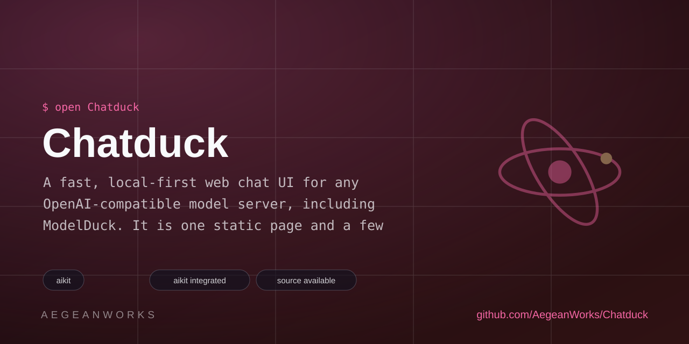

# ChatDuck

<!-- aegean:media:start -->
<p align="center"></p>
<p align="center"><a href="LICENSE"></a> <a href="https://github.com/AegeanWorks/AIKit"></a></p>
<!-- aegean:media:end -->


A fast, local-first web chat UI for any OpenAI-compatible model server, including ModelDuck. It is one static page and a few modules: no build step, no framework, no backend, and no telemetry.

## ⚡ 30-Second Cold-Start Quick Reference

- **Runtime Prerequisites**: Node.js 20 or newer (only to serve the static files and run the tests). A browser with `fetch` and `ReadableStream`. No `npm install` is needed.
- **Start it with one click (Windows)**: double-click **`start.bat`**. It starts
  the local server and opens ChatDuck in your browser.
  On macOS/Linux run `npm run start:open`, or `npm start` and open
  **http://127.0.0.1:4173** yourself.
  Then open **Settings** and enter your server URL, model and API key.
- **Canonical Regression Shield Gate**:
  ```bash
  npm test
  ```

### Connect to ModelDuck

1. Start ModelDuck (`npm start -- --no-open --port 4141`) and load a model.
2. In ModelDuck **Settings → Server**, turn on **Require authentication** and **Enable CORS** (CORS needs authentication), then create an API key.
3. In ChatDuck **Settings**, set **Server URL** to `http://127.0.0.1:4141`, paste the key, and pick the model from the list (or type it).

ChatDuck is served from `127.0.0.1:4173`, so the browser treats `127.0.0.1:4141` as another origin; that is why CORS is needed. The same settings work with Ollama, LM Studio or any other server that implements `GET /v1/models` and `POST /v1/chat/completions`.

## What it does

- Streams answers token by token, with **Stop** (or `Esc`), copyable messages and code blocks, and **Regenerate / Retry** for the latest answer. Failed requests show a one-click **Retry**. While a reply streams, you can scroll back through the chat and use **Jump to latest** to return.
- **Edit & resend**: every user message has **Edit**, which replaces it, drops later replies, and replays from there. Every message has **Copy** and **Delete**.
- **Thinking traces**: `reasoning_content` deltas and `<think>` blocks (Qwen, DeepSeek-R1 style) render in a collapsible *Thinking* section, toggleable in Settings, so they never leak into the answer.
- **Vision**: attach up to 4 images per message (📎 button, paste, or drag-and-drop) for vision-capable models; images are downscaled locally and sent as OpenAI content parts. Text-only servers keep receiving plain strings.
- **Text files**: attach up to 3 code/text files per message — they are inlined as labeled fenced blocks (truncated at 12k chars with a note), so any server can read them with no special API.
- **Conversation tools**: rename (✎ in the header), duplicate, per-chat token estimate, last-reply latency and tok/s, **Export** (copy as Markdown) and **↓ .md** download (Shift-click for JSON with images), **Import** for chat JSON files, plus a live character/token counter in the composer.
- **Shortcuts**: `Ctrl/⌘+K` new chat, `/` focuses search, `Esc` cancels edits, stops streaming, or closes the sidebar. Suggestion cards send immediately, and the model list refreshes whenever Settings opens.
- Renders Markdown safely: raw HTML is escaped; tables, task lists, strikethrough, `---` rules, bare `http(s)` links, and fenced code with language labels are supported.
- Keeps chats and search in this browser (`localStorage`); the API key stays in `sessionStorage` and is forgotten when the tab closes.
- Lists models from `/v1/models`, remembers the server URL and model, and supports a custom system prompt (or a one-click preset: coding assistant, explainer, reviewer, summarizer), temperature, top-p, frequency/presence penalties, an optional seed and max tokens.
- Model picker in the header: switch models without opening Settings; the list refreshes from the server automatically.
- Opt-in AI titles: Settings can ask the model for a short title after the first exchange, replacing the first-line title (kept on any failure).
- Server token counts: when the server reports `usage`, replies show real `in · out` numbers instead of estimates.
- Pinned chats: star any conversation to keep it at the top of the sidebar above recency order.
- Context meter in the header estimates token usage against the reply budget (warns past 80%); every message shows its send time.
- Library controls in Settings: **Backup all** downloads every chat as one JSON file, **Import** restores single chats or full backups, and **Clear all…** wipes the library with confirmation.
- Installable: ships a web manifest so it can be added to the home screen / app list like a native chat app.
- Works with one or several servers by changing the URL in Settings.
- Light, dark, and follow-system themes, a responsive sidebar, and no network requests except to the server you configure.

## Privacy and security

ChatDuck has no backend and sends nothing anywhere except the server URL you enter. Conversations are stored in this browser only. The API key is session-scoped. Rendered model output is escaped first; links are limited to `http` and `https`. Clearing site data removes local chats and settings.

## 📦 What's Inside

```text
chatduck/
├── .gitignore
├── LICENSE
├── COMMERCIAL.md
├── LICENSES/
├── REUSE.toml
├── public/
│   ├── index.html   <- one page: sidebar, chat, settings
│   ├── manifest.webmanifest <- installable-app metadata
│   ├── app.js       <- state, streaming, edit/retry/export, settings
│   ├── openai.js    <- /v1 client, SSE parsing, reasoning, vision parts, errors
│   ├── chat.js      <- regenerate/edit and scroll predicates
│   ├── store.js     <- settings, history ops (rename/duplicate/edit/export)
│   ├── markdown.js  <- escaping-first Markdown renderer + tables/think
│   ├── favicon.svg  <- the duck mark
│   └── styles.css   <- responsive dark/light theme
├── scripts/
│   └── serve.mjs    <- dependency-free static server
├── tests/
│   ├── openai.test.js
│   ├── chat.test.js
│   ├── markdown.test.js
│   ├── store.test.js
│   └── serve.test.js
├── package.json
├── README.md
├── assets/         <- brand logo and social preview
├── start.bat       <- one-click Windows launcher
└── .aikit/          <- this project's memory: ledger and decisions
```

## Development

```bash
npm start          # serve http://127.0.0.1:4173
npm run start:open # serve and open the browser (used by start.bat)
npm run dev        # restart when files change
npm test           # client, storage, Markdown and static-server tests
```

## AIKit Commands (run from the AIKit folder)

| Role | Command |
|---|---|
| Status, task and gates | `python aikit.py status chatduck` |
| Phase 4: every gate | `python aikit.py check chatduck` |
| Repair memory and map, then check | `python aikit.py fix chatduck` |
| Resume an interrupted task | `python aikit.py resume chatduck` |

<!-- aegean:brand-assets:start -->
## 🎨 Brand Assets

> **AI-Generated Brand Artwork.** The banner and logo are **AI-generated brand assets**. They are illustrative and may not literally depict every feature or the full project scope.
<!-- aegean:brand-assets:end -->

## License

Free for personal use under the Aegean License 1.1 (AL-1.1); see [LICENSE](LICENSE). Any commercial use needs the Aegean Commercial License 1.0 (ACL-1.0); see [COMMERCIAL.md](COMMERCIAL.md).
